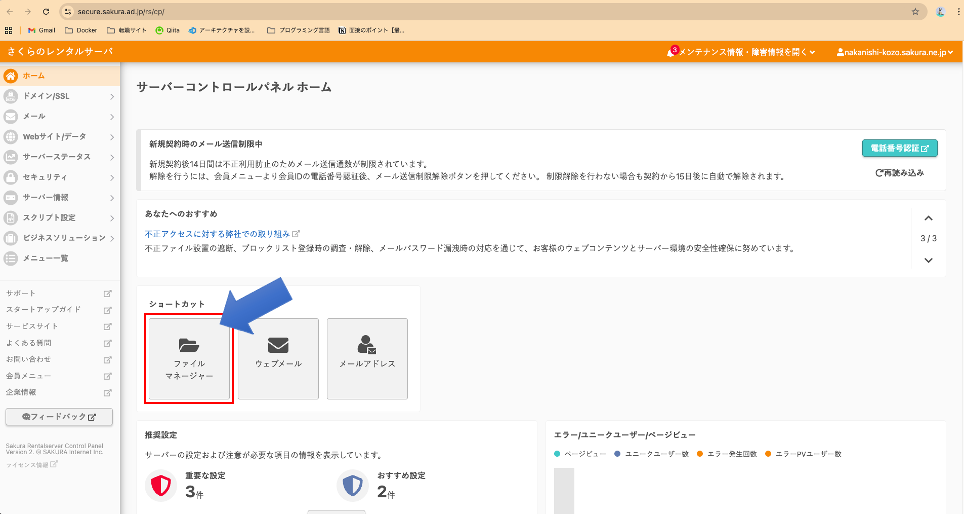
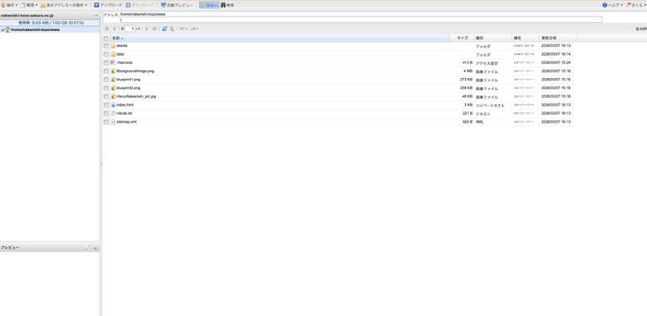
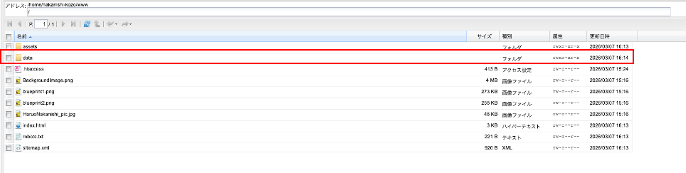
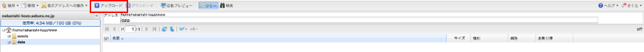
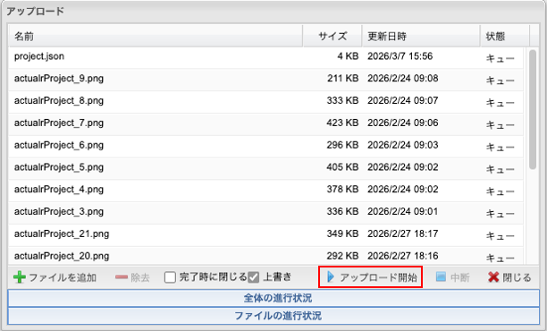

# 実績管理ツール（マクロ）初期設定・操作手順書

このツールは、Excelに入力した内容をWebサイト用のデータ（JSONファイル）に変換し、画像と一緒に整理するためのものです 。

---

## 前提：実績概要出力マクロ.xlsmとpublicフォルダは同じフォルダ内に配置ください

NKNSフォルダ  
└─ publicフォルダ  
└─ 実績概要出力マクロ.xlsm

**理由**: 実行すると、「public」という名前の画像保存用フォルダにシステムに反映できるファイルを作成します。

---

## （初期設定）ステップ1：Excelの「隠し機能」を有効にする

このツールを動かすために、一度だけ「参照設定」という設定が必要です。

1. Excelを開き、キーボードの **[Alt] キーを押しながら [F11] キー** を押します。
2. 英語のウィンドウが開いたら、上のメニューの **[ツール]** → **[参照設定]** をクリックします。
   
3. リストの中から **「Microsoft Scripting Runtime」** を探し、左の四角にチェックを入れます。
   
4. **[OK]** を押して閉じます。

---

## （実績データ更新）ステップ2：実績データを入力する

Webサイトに載せる情報を書き込みます。

1. **「実績概要」シート** を開きます（マクロがこの中身を読み取ります） 。

2. **7行目** から入力を開始してください 。

3. **B列（タイトル）：** 実績のタイトルになります。
4. **C列（年月日）：** 対応した年月日になります。
5. **D列（詳細）：** 実績に関する詳細情報になります。
6. **E列（カテゴリー）：** 鉄骨造や木造などの情報になります。カンマ「,」で区切ると複数の情報を表示できます。
7. **F列（場所）：** 実績に関連する場所になります。

※いずれも未入力であれば画面上に表示されません。  
入力した内容は以下のレイアウトで画面上に表示されます。

---

## （実績データ更新）ステップ3：画像を登録・削除する

シート上のボタンを使って、パソコン内の画像を登録します。

- **画像を追加する場合**:

1. 「画像追加」ボタンを押すと、ファイルを選ぶ画面が出ます 。

- **画像を削除する場合**:

1. 「削除」ボタンを押すと、その行の画像ファイルがパソコン内から消去され、セルの文字もクリアされます 。

---

## （実績データ更新）ステップ4：Web用のデータを出力する

内容をファイル群として出力します。

1. 「JSON出力」ボタンを実行します 。
2. 「project.json を出力しました」というメッセージが出れば成功です 。
3. Excelと同じフォルダ内の **「public」フォルダ** を開くと、**`project.json`** というファイルができています。また、画像も併せて出力されています。

---

## （実績データ更新）ステップ5：Webサイトに反映する（さくらのレンタルサーバ）

出力したファイルをWebサーバーにアップロードして、Webサイトに反映します。

### 5-1. さくらのコントロールパネルにログイン

1. ブラウザで [https://secure.sakura.ad.jp/rscontrol/](https://secure.sakura.ad.jp/rscontrol/) にアクセスします。
2. ドメイン名（またはアカウント名）とパスワードを入力してログインします。
   (ユーザー名・パスワードは別途連絡します。)

### 5-2. ファイルマネージャーを開く

1. コントロールパネルのメニューから **「ファイルマネージャー」** をクリックします。
   
2. 新しいタブでファイルマネージャーが開きます。
   

### 5-3. dataフォルダに移動

1. `www` フォルダ内の **`data`** フォルダをクリックして開きます。
   

### 5-4. 既存ファイルを削除する

1. `data` フォルダ内の既存ファイルを全て選択します。
   - `project.json`
   - `actualrProject_*.png`（画像ファイル全て）
2. **左上の「操作」→「削除」** ボタンをクリックして削除します。

### 5-5. 新しいファイルをアップロードする

1. ファイルマネージャーの **「アップロード」** ボタンをクリックします。
   
2. ファイル選択画面が表示されるので、以下のファイルを選択します：
   - **`project.json`** （Excelで出力したファイル）
   - **`actualrProject_*.png`** （画像ファイル全て）

> **ポイント**: `public` フォルダ内のファイルを直接選択してください。フォルダごとアップロードするのではなく、**ファイルの中身だけ**をアップロードします。

3. **「アップロード開始」** をクリックします。
   
1. アップロードが完了するまで待ちます（ファイル数によっては数分かかる場合があります）。

### 5-6. アップロード完了の確認

1. `data` フォルダ内に以下のファイルがあることを確認します：
   - `project.json`
   - `actualrProject_3.png`
   - `actualrProject_4.png`
   - （その他の画像ファイル）

2. ブラウザで Webサイト（`https://nakanishi-kozo.sakura.ne.jp/`）にアクセスします。
3. **「実績」** ページを開いて、更新した内容が正しく表示されているか確認します。

> **トラブルシューティング**: もし更新が反映されない場合は、ブラウザのキャッシュをクリアするか、Ctrl+F5（Windows）/ Command+Shift+R（Mac）でページを強制リロードしてください。

---

## 更新作業の流れ（まとめ）

日常的な更新作業は以下の流れで行います：

1. **Excelファイルを開く** → 実績データを入力・編集
2. **「JSON出力」ボタンをクリック** → `public` フォルダにファイルが出力される
3. **さくらのファイルマネージャーを開く** → `www/data/` フォルダに移動
4. **既存ファイルを削除** → 古いファイルを全て削除
5. **新しいファイルをアップロード** → `public` フォルダ内のファイルを選択してアップロード
6. **Webサイトで確認** → 正しく表示されているか確認

---
